# food-delivery-devsecops-release-pipeline

**Platewise** is a food-delivery web app for restaurant discovery and ordering in Pune: a React SPA
on top of a hardened, dependency-free Node.js API. You can search restaurants and dishes, filter by
cuisine, pure-veg and rating, build a cart, apply coupons, get a GST-correct bill and place an
order, then track it. It ships through a security-gated **Jenkins** pipeline: ESLint and Vitest
with a coverage gate, **SonarQube** with a quality gate, **OWASP Dependency-Check**, `npm audit`,
**Trivy** (filesystem, IaC and image), **gitleaks**, **OPA/conftest** and **Checkov**, a
**CycloneDX SBOM**, then a distroless image pushed to **Amazon ECR** by digest. After a manual
approval, **kubectl** rolls it out to **Kubernetes** (Kustomize, restricted Pod Security,
default-deny NetworkPolicies), and rolls it back automatically if the rollout fails.
**Terraform** provisions the CI toolchain on **AWS** (private Jenkins controller, Docker build
agent and SonarQube on EC2, reachable only through SSM Session Manager). **Prometheus** and
**Grafana** track both API health and business metrics (orders, order value, coupons).

> **Status:** built and checked locally with Docker Compose and a throwaway kind cluster. Nothing
> in this repo has been deployed: no `terraform apply`, no published image, no real cluster.
> GitHub Actions is disabled for this repository; Jenkins is the CI system. The steps to deploy it
> yourself are below.

## Architecture

```mermaid
flowchart LR
  dev([git push]) --> ctrl

  subgraph aws[AWS ap-south-1, Terraform: private subnet, SSM-only access]
    ctrl[Jenkins controller<br/>JCasC, 0 executors] --> agent[Docker build agent<br/>EC2 instance role]
    sonarq[(SonarQube + PostgreSQL)]
    ecr[(ECR food/platewise<br/>immutable, scan on push, KMS)]
    ssm[(SSM SecureString<br/>/platewise/ci/*)] -.secrets at boot.-> ctrl
  end

  subgraph gates[Blocking quality and security gates]
    q[ESLint + Vitest coverage gate<br/>hadolint, ShellCheck, yamllint<br/>kubeconform, conftest, promtool<br/>terraform validate/test, TFLint] --> sq[SonarQube<br/>quality gate]
    sq --> sc[OWASP Dependency-Check<br/>npm audit, Trivy FS/IaC, gitleaks]
    sc --> img[docker build<br/>distroless, UID 65532]
    img --> ti[Trivy image scan<br/>+ CycloneDX SBOM]
    ti --> smoke[compose smoke test<br/>order flow + metrics]
  end
  agent --> q
  sq <--> sonarq

  smoke -->|main + PUBLISH| ecr
  smoke -->|main + PUBLISH| bump[Release manifest:<br/>production overlay tag@digest]
  bump -->|main + DEPLOY + approval| deploy[kubectl apply<br/>rollout status / auto rollback]

  subgraph k8s[Kubernetes namespace platewise, Pod Security: restricted]
    ing[Ingress nginx<br/>TLS, rate limits] --> svc[Service] --> pods[Platewise pods x3..10<br/>read-only FS, no SA token]
    hpa[HPA] --> pods
    key[(Secret platewise-order-signing<br/>mounted as a file)] -.-> pods
  end
  deploy --> k8s
  ecr --> pods

  subgraph mon[Monitoring]
    prom[Prometheus<br/>11 rules, unit-tested] --> graf[Grafana dashboard]
  end
  pods -->|/metrics| prom
```



**Order path:** the browser calls only this app's `/api`. Menus and prices live on the server; the
client sends item ids and quantities, and the API re-validates and re-prices every cart (integer
paise, 5% GST, packaging, delivery fee, coupons), so a tampered client cannot change a price.
An order id is the order itself, HMAC-SHA256 signed with a shared key: any replica can verify
and track it without a database, and a forged or altered id is rejected.

## What's inside

| Area | What it does |
| --- | --- |
| App (`app/`) | React 19 + Vite SPA; Node.js 24 API on `node:http` with zero runtime dependencies. Search, filters, sorting, menus, cart, coupons (`WELCOME50`, `FLAT75`, `FREEDEL`), quotes, signed orders with time-based tracking. Strict CSP and security headers, per-client token-bucket rate limiting, JSON-only bodies with a size cap, graceful SIGTERM drain, Prometheus `/metrics`. 78 Vitest tests, coverage gate at 90/85/90/90 (statements/branches/functions/lines). |
| Container (`Dockerfile`) | Multi-stage: lint + tests + build run inside the build, then a digest-pinned distroless `nodejs24` runtime as UID 65532 with an exec-form HEALTHCHECK. No shell, no package manager, no `node_modules` in the final image. |
| Pipeline (`Jenkinsfile`, `ci/jenkins/`) | Declarative pipeline (stages below). Jenkins controller image with pinned LTS, plugins and configuration-as-code (`scripts/jenkins-lint.sh` boots it and runs the declarative linter). |
| Kubernetes (`deploy/k8s/`) | Kustomize base + `kind` and `production` overlays + a monitoring component (ServiceMonitor, PrometheusRule generated from the tested rules). Restricted Pod Security, default-deny NetworkPolicy with **no egress at all**, HPA, PDB, topology spread, startup/readiness/liveness probes, signing key mounted from a Secret file. |
| Infrastructure (`infra/terraform/`) | VPC (2 AZs, private subnets, single NAT, flow logs to KMS-encrypted CloudWatch), least-privilege security groups (no internet ingress, HTTPS-only egress), three AL2023 hosts (IMDSv2, encrypted gp3, detailed monitoring, no SSH keys), per-host IAM roles that read only their own SSM parameters, ECR push only from the agent role, rotating KMS key. 12 mocked `terraform test` runs. |
| Policy (`policy/`) | OPA/conftest rules for Kubernetes workloads, Dockerfiles and the compose file, with their own unit tests (`conftest verify`). |
| Monitoring (`monitoring/`) | Prometheus config, 5 recording + 6 alerting rules (down, 5xx ratio, p95 latency, orders stalled while quotes flow, cart rejections, rate limiting) with `promtool` unit tests; a provisioned Grafana dashboard. |

### Pipeline stages

| Stage | Tools | Fails the build when |
| --- | --- | --- |
| Install | `npm ci` from the lockfile | lockfile drift |
| Quality (parallel) | ESLint, Vitest + coverage, `scripts/check-config.sh` (hadolint, ShellCheck incl. rendered EC2 bootstrap scripts, ruff, yamllint, compose config, kubeconform, conftest, promtool, terraform fmt/validate/test, TFLint) | any lint error, failing test, coverage under the gate, policy violation |
| SonarQube analysis + quality gate | sonar-scanner, `waitForQualityGate` | the project's quality gate fails |
| Supply chain (parallel) | OWASP Dependency-Check, `npm audit`, Trivy FS + misconfig, gitleaks | CVSS >= 7, moderate+ advisories, HIGH/CRITICAL findings, any leaked secret |
| Build image | `docker build --pull` | the in-image lint/test/build fails |
| Scan image | Trivy image + CycloneDX SBOM | fixable HIGH/CRITICAL vulnerabilities |
| Smoke test | `scripts/compose-smoke.sh` | the real image fails the order flow, hardening, metrics or Grafana checks |
| Publish image (`main` + `PUBLISH`) | ECR login with the agent's instance role, push | push fails |
| Release manifest (`main` + `PUBLISH`) | `scripts/release-bump.sh` pins `tag@digest` in the production overlay and commits it | invalid tag/digest/image |
| Deploy (`main` + `PUBLISH` + `DEPLOY`, human approval) | `kubectl diff`, server-side apply, `rollout status` | rollout fails, after an automatic `rollout undo` |

## Repository layout

```text
app/                      React SPA (src/web) + Node.js API (src/server), Vitest tests
ci/jenkins/               Jenkins controller image: pinned LTS, plugins.txt, casc/jenkins.yaml
deploy/k8s/               Kustomize base, overlays (kind, production), monitoring component
deploy/kind/              2-node kind cluster for the local rehearsal
infra/terraform/          AWS CI toolchain (VPC, EC2 x3, IAM, KMS, ECR) + mocked tests
monitoring/               Prometheus config, rules + rule tests, Grafana provisioning + dashboard
policy/                   conftest/OPA policies and policy tests
scripts/                  check-all, check-config, compose/kind smoke tests, jenkins-lint, release-bump
Jenkinsfile               the pipeline
compose.yaml              local stack: app + Prometheus + Grafana
sonar-project.properties  SonarQube project settings (lcov coverage from Vitest)
```

## Prerequisites

- Node.js 24 and npm
- Docker with the Compose plugin
- For `make check`: hadolint, ShellCheck, ruff, yamllint, kustomize, kubeconform, conftest,
  promtool, Terraform >= 1.10, TFLint, Checkov, Trivy, gitleaks, jq
- For `make kind-smoke`: kind and kubectl

## Run it locally

### 1. App only

```bash
cd app
npm ci
npm run build && npm start          # http://localhost:8080
# or, for UI work: npm start in one terminal and npm run dev in another (Vite on :5173, /api proxied)
```

Without `ORDER_SIGNING_KEY` the server makes a random per-process key and logs a warning; that is
fine for one local process. With `NODE_ENV=production` it refuses to start without a key.

### 2. Full stack with monitoring

```bash
cp .env.example .env
# put a fresh value in each line: openssl rand -hex 32
docker compose up -d --build
```

- Platewise: <http://127.0.0.1:8080> (try coupon `WELCOME50` on an order above ₹199)
- Prometheus: <http://127.0.0.1:9090> (Status > Rules shows the 11 rules)
- Grafana: <http://127.0.0.1:3000> as `admin` with your `GRAFANA_ADMIN_PASSWORD`; dashboard
  "Platewise: orders and API health"

Every container runs read-only, with all capabilities dropped and `no-new-privileges`, and every
port is bound to `127.0.0.1`. Stop with `make down` (also removes the volumes).

### API quick reference

```bash
curl 'http://127.0.0.1:8080/api/restaurants?veg=true&sort=rating'
curl http://127.0.0.1:8080/api/restaurants/misal-mandal
curl -H 'content-type: application/json' \
  -d '{"restaurantId":"misal-mandal","items":[{"id":"mm-misal-pav","qty":2}],"coupon":"WELCOME50"}' \
  http://127.0.0.1:8080/api/quote
curl -H 'content-type: application/json' \
  -d '{"restaurantId":"misal-mandal","items":[{"id":"mm-misal-pav","qty":2}],"customerName":"Asha"}' \
  http://127.0.0.1:8080/api/orders          # 201, returns orderId
curl http://127.0.0.1:8080/api/orders/<orderId>
```

Amounts are integer paise. Health: `/healthz/live`, `/healthz/ready`; build info: `/version`.

## Checks

```bash
make check          # every offline gate (scripts/check-all.sh)
make compose-smoke  # build + run the stack, exercise it, tear it down
make kind-smoke     # build the image, rehearse the rollout on a throwaway kind cluster, delete it
make jenkins-lint   # boot the JCasC Jenkins image locally and validate the Jenkinsfile
```

`make check` runs: `npm ci`, ESLint, Vitest with the coverage gate, the production build,
`npm audit`, hadolint, ShellCheck (scripts and the rendered Terraform bootstrap templates), ruff,
yamllint, `docker compose config`, kustomize + kubeconform (strict), `conftest verify` and
`conftest test` (manifests, Dockerfiles, compose), `promtool check`/`test rules`, a PrometheusRule
drift check, Grafana JSON checks, `terraform fmt`/`validate`, TFLint, `terraform test` with a
mocked AWS provider, Checkov (Dockerfiles, rendered manifests, Terraform), Trivy filesystem
(vulnerabilities, secrets, misconfigurations) and gitleaks (history and working tree).

The kind rehearsal uses its own temporary kubeconfig, so it cannot touch another cluster. It
proves that pods do not start without the signing-key Secret, that the HPA scales to two ready
replicas under restricted Pod Security, that a privileged pod is rejected, that an order placed
through the Service is verified by **each** replica, and that a rolling restart respects the PDB.

### Results of the last local run (Nov 27, 2026)

| Check | Result |
| --- | --- |
| Vitest | 78 tests passed; coverage 98.6% statements, 95.9% branches, 96.9% functions, 98.5% lines |
| ESLint, Vite build, `npm audit` | clean, built, 0 vulnerabilities |
| conftest | 20 policy unit tests; 374 + 12 + 6 checks on manifests, Dockerfiles and compose, 0 failures |
| kubeconform | 22 resources valid (strict) |
| promtool | 11 rules, rule unit tests pass |
| Terraform | fmt, validate, TFLint clean; `terraform test` 12 passed with a mocked provider |
| Checkov | Dockerfile 92 passed / 0 failed; Kubernetes 186 / 0; Terraform 181 / 0 (skips are inline, with reasons) |
| Trivy | filesystem: 0 HIGH/CRITICAL; image: 0 fixable HIGH/CRITICAL |
| gitleaks | no leaks in history or working tree |
| Compose smoke test | passed (11 checks) |
| kind smoke test | passed (NetworkPolicy deny check skipped: the host kernel lacks NFQUEUE) |
| Jenkins lint | JCasC controller booted, 403 for anonymous, CSRF on, 4 credential IDs, Jenkinsfile validated by the declarative linter |

## Deploy it yourself (later)

Everything below creates real, billable resources in **your** AWS account and cluster. Nothing
here has been applied for you.

### 1. CI toolchain on AWS (Terraform)

```bash
cd infra/terraform
cp backend.hcl.example backend.hcl            # your state bucket
cp terraform.tfvars.example terraform.tfvars  # region, sizes, repository ref
terraform init -backend-config=backend.hcl
terraform plan -out ci.tfplan
terraform apply ci.tfplan
```

Then create the secrets the hosts wait for, as SecureString parameters with the CI key (they
never touch Terraform state). `KEY=$(terraform output -raw kms_key_alias)`:

```bash
P=/platewise/ci
put() { aws ssm put-parameter --type SecureString --key-id "$KEY" --name "$1" --value "$2" --overwrite; }
put $P/controller/admin-password            "$(openssl rand -base64 24)"
put $P/controller/release-approver-password "$(openssl rand -base64 24)"
put $P/controller/admin-email               "you@example.com"
put $P/controller/nvd-api-key               "<your NVD API key>"
put $P/controller/github-push-user          "<GitHub user>"
put $P/controller/github-push-token         "<fine-grained token, contents:write on this repo>"
put $P/controller/kubeconfig                "$(cat namespace-scoped-kubeconfig.yaml)"
put $P/sonarqube/db-password                "$(openssl rand -base64 24)"
```

1. Open SonarQube with `$(terraform output -raw open_sonarqube)` on <http://localhost:9000>,
   change the default admin password, create the `platewise` project and a token, and add a
   webhook to `http://10.40.16.10:8080/sonarqube-webhook/`. Store the token last:
   `put $P/controller/sonar-token "<token>"`. The controller bootstrap waits for it, then builds
   and starts Jenkins.
2. Open Jenkins with `$(terraform output -raw open_jenkins)` on <http://localhost:8080>.
3. Copy the secret of node `docker-agent-1` into `$P/agent/agent-secret`; the agent connects by itself.
4. Create a Multibranch Pipeline for this repository (the controller has no inbound internet path,
   so use periodic branch scanning rather than webhooks).

### 2. Kubernetes

Prerequisites in the cluster: ingress-nginx, cert-manager with a `letsencrypt-prod`
ClusterIssuer, kube-prometheus-stack (for the ServiceMonitor and PrometheusRule), metrics-server
(for the HPA). Then:

```bash
# 1. Set your hostname in deploy/k8s/overlays/production/ingress.yaml.
# 2. Create the namespace and the signing key out of band (never commit it):
kubectl apply -f deploy/k8s/base/namespace.yaml
kubectl -n platewise create secret generic platewise-order-signing \
  --from-literal=signing-key="$(openssl rand -hex 32)"
# 3. Run the Jenkins job on main with PUBLISH=true (push + pin), then DEPLOY=true and approve.
```

## Limitations

- Restaurants and menus are a curated in-code catalog; there are no payments, accounts, real
  riders or delivery tracking. Order status is derived from the time since ordering.
- Order ids are signed, not encrypted: the customer's first name and the order total are readable
  by whoever holds the id. Rotating the signing key invalidates existing order ids.
- Rate limiting is per pod and in memory; the Ingress adds a per-client limit on top.
- The CI hosts run in one AZ with one NAT gateway, and SonarQube's PostgreSQL runs on the same
  host. That suits a CI toolchain, not a highly available service. Rough on-demand cost in
  ap-south-1 is about USD 0.28 per hour while all three hosts and the NAT gateway run; stop the
  instances when idle.
- The build agent installs its toolchain at boot from pinned upstream releases without checksum
  verification; for a fleet, bake an AMI with Packer instead.
- Jenkins is reachable only through SSM port forwarding, so GitHub webhooks cannot reach it.
- The kind rehearsal could not exercise the NetworkPolicy deny path on this host kernel
  (no NFQUEUE), and SonarQube, Dependency-Check, ECR push and the Deploy stage were not run.

## Cleanup

```bash
make down                                     # local stack and volumes
kind delete cluster --name platewise-smoke    # only if you ran the kind test with KEEP=1
make clean                                    # build output, reports, node_modules
# If you deployed: kubectl delete -k deploy/k8s/overlays/production
#                  kubectl -n platewise delete secret platewise-order-signing
# AWS: empty the ECR repository, delete the /platewise/ci/* parameters, then
#      cd infra/terraform && terraform destroy
```

## Credits

Inspired by DevOps-Project-13, "Zomato Clone: Secure Deployment with DevSecOps CI/CD", in
[NotHarshhaa/DevOps-Projects](https://github.com/NotHarshhaa/DevOps-Projects/tree/master/DevOps-Project-13)
by [Harshhaa](https://github.com/NotHarshhaa). This repository is an independent implementation:
the app, brand, pipeline, policies, infrastructure and tests are original.

## License

MIT, see [LICENSE](LICENSE).
